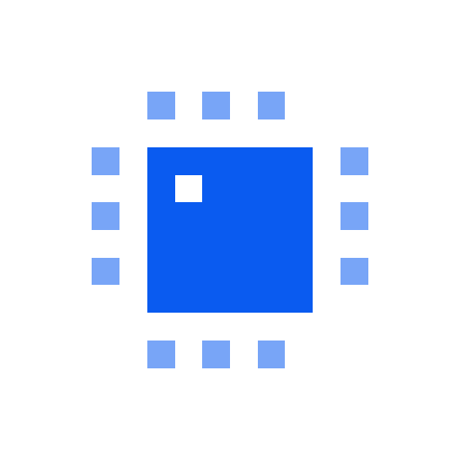

# PCBKit



[PCBKit](https://pcbkit.io) designs printed circuit boards with you. Describe what the board
should do — "a USB-C powered sensor node with an ESP32 and a temperature sensor" — and it is
written in PCBKit, a small board language with real units, built from proven circuit blocks
(regulators, USB, microcontroller support, protection). PCBKit checks the design (electrical rules,
clearances, the fab's limits), places the parts, routes the copper and fills the pours, then
exports Gerber and drill files with the bill of materials and placement list for the fab, or a
KiCad board to continue in KiCad. Ask for changes in plain words ("move the connector to the left
edge", "make the power tracks wider") and it changes the board and routes it again.

## Install

In Claude (claude.ai, Cowork, the desktop app): add PCBKit from the directory.

In Claude Code:

```sh
claude plugin marketplace add seralexeev/pcbkit-plugin
claude plugin install pcbkit@pcbkit
```

Then ask: "Make a board with an LED that blinks every 2 seconds."

## What it contains

- `.mcp.json`: the PCBKit MCP server, `https://mcp.pcbkit.io/mcp` (remote, streamable HTTP).
- `skills/pcbkit-boards`: how to design, change, check, route and export a board with its tools.
- `skills/setup`: introduces PCBKit and starts the first board.

The plugin runs nothing on your computer. The tools run on PCBKit's servers: the board's files
and the requests you make through the tools are sent to `mcp.pcbkit.io`, where the boards are kept
(one per conversation; signed-in boards with your account) and exports are kept as download links
for 7 days. No account is needed to start. See the [privacy policy](https://pcbkit.io/privacy) and
the [terms](https://pcbkit.io/terms).

## Limits

Two-sided and multilayer boards of everyday size and density; very large or high-speed boards may
not route completely, and PCBKit says which connections are missing. Review every design before you
order it.

Support: [pcbkit.io/support](https://pcbkit.io/support), support@pcbkit.io.
